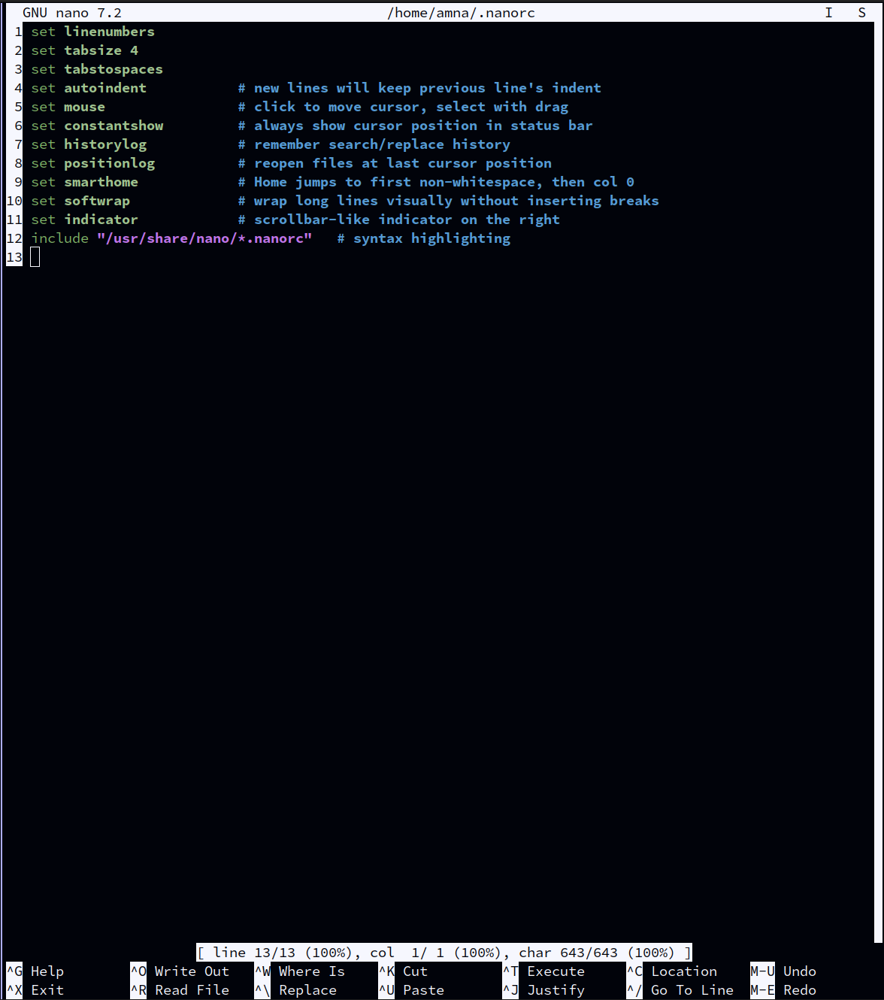
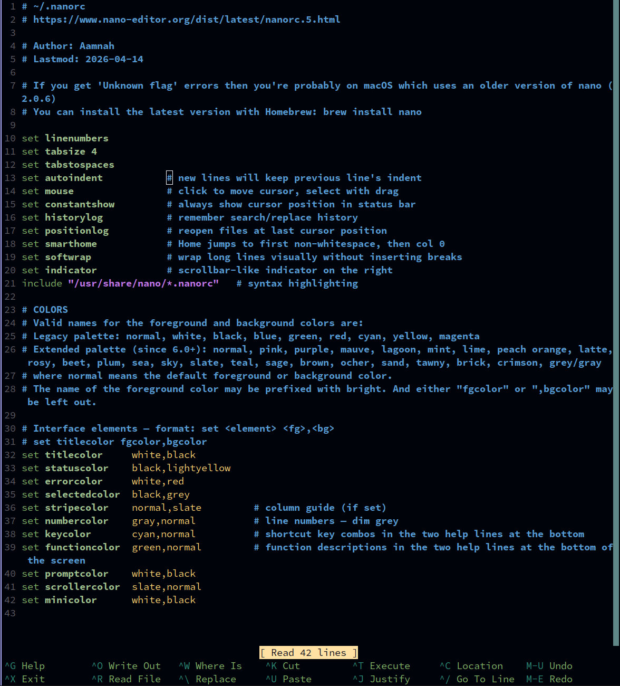

[nano](https://www.nano-editor.org/) is the simple terminal editor that's on almost every Linux
system. The config is installed to `~/.nanorc`.

| Default nano | With this config |
|---|---|
|  |  |

## Settings

| Setting | Effect |
|---|---|
| `linenumbers` | line numbers on the left |
| `tabsize 4` | Tab inserts a real tab character, shown 4 wide (same as Vim and Neovim) |
| `autoindent` | new lines keep the previous line's indent |
| `mouse` | click to move the cursor, drag to select |
| `constantshow` | always show the cursor position at the bottom |
| `historylog` | remember search/replace history |
| `positionlog` | reopen files where you left off |
| `smarthome` | Home jumps to the first non-space character, then to column 0 |
| `softwrap` | long lines wrap on screen without changing the file |
| `indicator` | a scrollbar-like position marker on the right |

## Syntax highlighting

```
include "/usr/share/nano/*.nanorc"
```

loads nano's built-in highlighting rules. They're in a different place on each system, so the
installer rewrites this line when it copies the file:

| System | Folder |
|---|---|
| Linux | `/usr/share/nano` |
| macOS, Apple Silicon (Homebrew) | `/opt/homebrew/share/nano` |
| macOS, Intel (Homebrew) | `/usr/local/share/nano` |

The repo keeps one file with the Linux path; the installer changes it during the copy, rather
than keeping three versions of the file.

## Spell check

```sh
sudo apt install aspell aspell-en       # Linux
brew install aspell                     # macOS
```

In a file, press **Ctrl+T** twice: the first opens the "execute" prompt, the second runs the
spell checker (`aspell -c`).

## Colours

The bars (title, status, prompts) use muted `brightblack` backgrounds. In kitty you can make
text semi-transparent but not backgrounds, so bright bars would stand out in inactive tabs.
Line numbers are dim grey; the help shortcuts at the bottom are cyan and green.

## Edge cases

- **macOS ships nano 2.0.6** (from 2008). It doesn't understand most of these settings and shows
  `Unknown flag` errors. Install a current nano: `brew install nano`. The installer warns about
  this on macOS.
- **Colour names like `slate` and `grey`** need a recent nano (6.0+). Older versions report
  unknown colours.
- **The installer doesn't install nano** — only the config.
- **YAML doesn't allow tabs.** Vim and Neovim switch to spaces for YAML files automatically;
  nano doesn't, so indent YAML with spaces by hand. (nano can do it per file type with
  `extendsyntax yaml tabgives "  "`, but that line errors on start-up wherever nano's syntax
  files are missing, so it isn't in the config.)
- **`/usr/share/nano does not exist`** warning: nano (or its syntax files) isn't installed.
  Highlighting won't load until it is; everything else works.
- **Installed to `~/.nanorc`, not `~/.config/nano/nanorc`.** The repo keeps the file under
  `.config/nano/` but installs it to the classic location. nano reads `~/.nanorc` **first**, so
  if both exist, `~/.config/nano/nanorc` is ignored.
