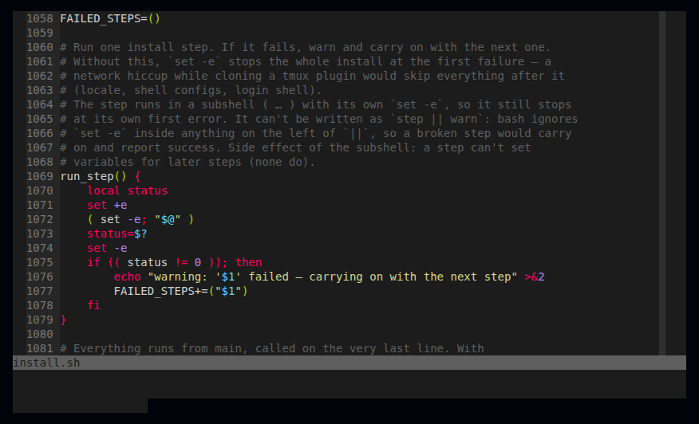

`.vimrc` is a classic Vim config. The installer copies it to `~/.vimrc`, but doesn't install
Vim itself (`sudo apt install vim` or `brew install vim`). For Neovim, see
[Neovim](/dotfiles/editors/neovim/).

## Colour scheme

Vim uses **[Sublime Monokai](https://github.com/ErichDonGubler/vim-sublime-monokai)**. It's
included in the repo (`.vim/colors/sublimemonokai.vim`, MIT licence) and the installer copies it
to `~/.vim/colors/`, so there's nothing to download.

If you copy only `.vimrc` to a machine, without the colour scheme file, Vim falls back to the
built-in **`habamax`** (Vim 9+) or **`desert`** (older Vims) instead of showing an error.

## Settings

| Area | Settings |
|---|---|
| Display | line numbers, cursor position, window title, wrapped lines, 2-line command area, status line always on |
| Width | window 120 columns wide, guide line at column 90 |
| Indent | **tabs**, shown 4 wide; YAML gets 2 spaces (YAML doesn't allow tabs). Auto and smart indent, follows file type (`filetype indent on`) |
| Mouse | on (`mouse=a`) |
| Search | highlight matches, search as you type, ignore case unless you type a capital |
| Folding | fold column on, `{{{ }}}` markers, everything open when a file loads |
| History | 1000 commands, 1000 undo levels, hidden buffers |
| Encoding | UTF-8 |
| Auto-reload | files changed outside Vim reload when the cursor stops moving |

## Edge cases

- **`set columns=120`** resizes the *terminal window* in some terminals (or does nothing in
  others). Remove it if Vim fights your window size.
- **`set t_Co=256`** forces 256 colours; on very old terminals colours may look wrong.
- `set number`, `set ruler` and `syntax on` appear twice — harmless duplicates.
- **Same indent in all three editors**: Vim, [nano](/dotfiles/editors/nano/) and
  [Neovim](/dotfiles/editors/neovim/) all indent with tabs, shown 4 wide.
