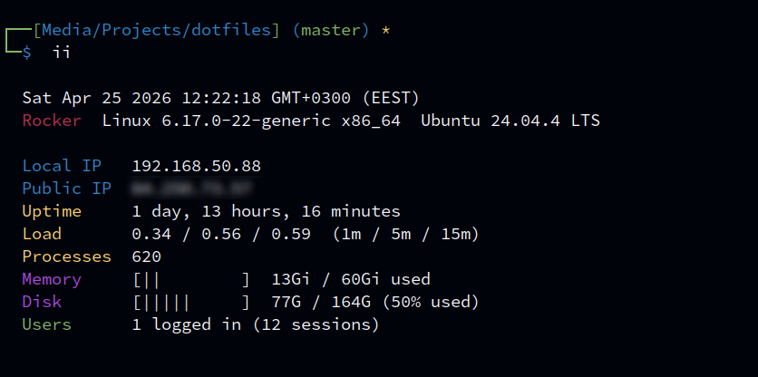
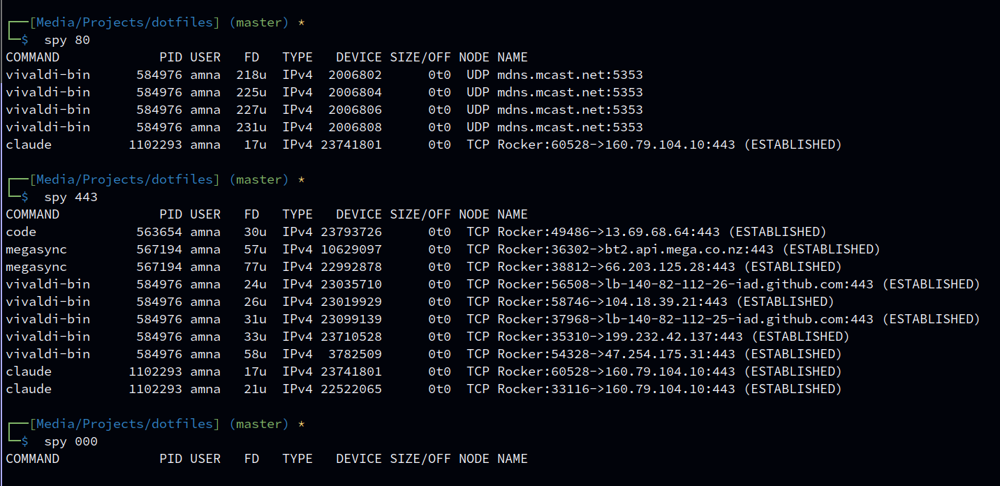

`~/.functions` is loaded by both bash and zsh. Functions can take arguments and run several
commands, which aliases can't.

## `take`

Make a folder (and any missing parent folders) and go into it.

```sh
take projects/new-app      # same as: mkdir -p projects/new-app && cd projects/new-app
```

## `ii`

A compact summary of the machine — like the message you see after SSH-ing into a server.



Shows: date and time, hostname, kernel and OS name, local and public IP, uptime, load average
(1 / 5 / 15 minutes), number of processes, memory and disk use with a 10-character bar, and
logged-in users.

- **Bars change colour** by usage: white under 60%, yellow 60–84%, red 85% and up.
- **Users** counts distinct people, not sessions — five tmux panes are still one user.
- **Works on Linux and macOS**, and shows `n/a` for anything it can't find instead of failing.
- **Public IP needs internet.** It waits at most 3 seconds (`curl --max-time 3`), then shows
  `n/a`.
- The local IP is the one on the interface that leads to the internet (same as [`myip`](#myip)).

## `myip`

All your IP addresses at once: the local one, and the public one asked two different ways.

```sh
myip
# Local        192.168.1.20
# ifconfig.me  203.0.113.31
# OpenDNS      203.0.113.31
```

With IPv6 available, a second column appears:

```sh
myip
#              IPv4             IPv6
# Local        192.168.1.20     2001:db8::20
# ifconfig.me  203.0.113.31     2001:db8::99
# OpenDNS      203.0.113.31     2001:db8::99
```

- **Local** — this machine's address on your network: the one on the interface that leads to the
  internet (Wi-Fi, Ethernet or VPN, whichever is in use), not just the first one listed.
- **ifconfig.me** — a web server reports the address your web traffic comes from.
- **OpenDNS** — a DNS server reports the address your DNS lookups come from.

The two public answers usually match. **If they differ**, web traffic and DNS leave through
different routes — for example a VPN or proxy that only covers one of them.

- **The IPv6 column only shows when an IPv6 address is found.** Without IPv6 internet you get the
  short IPv4 table. The IPv6 lookups fail instantly in that case, so `myip` stays fast.
- Each lookup gives up after 3 seconds and shows `-` instead of hanging.
- Needs `curl`. The OpenDNS row also needs `dig` (Debian/Ubuntu: `dnsutils`, Fedora: `bind-utils`,
  built into macOS); without it you see `install dig`.
- The local address comes from `ip route get` (Linux), `hostname -I` (older Debian/Ubuntu setups)
  or the default route's interface (macOS). Minimal containers may have none of these and show `-`.
- `localip` used to be a separate alias; it's part of `myip` now.

## `getwebsite`

Download a whole website to read offline.

```sh
getwebsite https://example.com/docs/
```

Runs `wget` with:

| Flag | Meaning |
|---|---|
| `-r` | follow links (recursive) |
| `-p` | also get images, CSS and JS each page needs |
| `-k` | rewrite links to point at the local copies |
| `-np` | never go *above* the starting folder |
| `-l 5` | at most 5 links deep (so it can't crawl forever) |
| `-e robots=off` | ignore `robots.txt` |
| `-U mozilla` | identify as a browser |
| `--random-wait` | vary the delay between requests, to avoid rate limits |

:::note
Only works for plain HTML sites. Sites built with JavaScript frameworks (single-page apps) come
out empty. For those, try `httrack`, `monolith` (saves one page as a single file), or the
browser's **Save Page As → Webpage, Complete**. Ignoring `robots.txt` means you're responsible
for not hammering someone's server.
:::

## `spy`

Show network connections, filtered by a port or program name.



```sh
spy 8080        # what's using port 8080?
spy chrome      # what is Chrome connected to?
sudo spy 443    # include other users' processes
```

It runs `lsof -i -P +c 0 +M` (internet connections, numeric ports, full program names) and
filters with `awk` so the **column header stays** — a plain `grep` would drop it.

- Matching ignores case and isn't a regex, so `127.0.0.1` matches literally.
- **Without `sudo` you only see your own processes.**

## `t`

Start a tmux session for the current folder, using a [tmuxp](/dotfiles/tools/tmuxp/) layout if
there is one.

It tries, in order:

1. `tmuxp.yaml` in the current folder
2. `~/.config/tmuxp/default.yaml`
3. A plain tmux session

The session is named after the folder. If the layout file doesn't set `session_name` (and
`start_directory`), `t` adds them for you in a temporary copy, so one default layout works for
every project.

```sh
cd ~/projects/dotfiles && t      # session "dotfiles"
```

Edge cases:

- **`tmuxp` not installed** → plain tmux session, with a note.
- **Folder names with `.` or `:`** are changed to `_` (tmux doesn't allow them in session
  names): `my.app` → `my_app`.
- **A session with that name already exists** → tmux refuses to create a second one. Attach
  with `tmux attach -t <name>` instead.
- **No `~/.config/tmuxp/default.yaml`** (the installer copies it, so only if you deleted it) →
  plain tmux session. See [tmuxp](/dotfiles/tools/tmuxp/).

## Removed functions

Older versions had a few more:

- `extract` — use the archive tool directly (`tar xf`, `unzip`).
- `sniff` — use `tcpdump` or `tshark`.
- `bell` — a terminal bell when a command finished; unreliable across terminals (also why
  `enable_audio_bell` left `kitty.conf`). Use [`alert`](/dotfiles/shell/aliases/#alert) instead.

## Adding your own

Machine-specific functions go in `~/.functions.local` — see
[Local files](/dotfiles/shell/local-files/).
