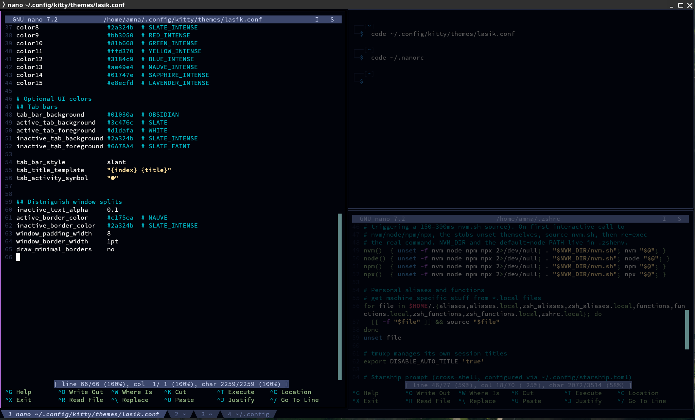

[kitty](https://sw.kovidgoyal.net/kitty/) is a fast, GPU-drawn terminal app. The config lives in
`~/.config/kitty/kitty.conf`.

The installer copies the config but **doesn't install kitty** — it's a desktop app, so on a
desktop without kitty you get a warning with the install command. On servers there's no warning:
you use kitty on your own computer and SSH *from* it.



## Font and window

| Setting | Value |
|---|---|
| Font | **Hasklug Nerd Font Mono**, 12 pt |
| Window size on open | 120 × 32 characters, every time (`remember_window_size no`) |

A *Nerd Font* is a programming font with thousands of extra icons added — prompts and tools use
them for symbols like the git branch icon. If Hasklug isn't installed, kitty silently uses a
fallback font and some icons show as boxes. Get it from
[nerdfonts.com](https://www.nerdfonts.com/font-downloads) (it's Hasklig with icons added).

## Theme

```
include themes/lasik.conf
```

**Lasik** matches the author's [VSCode theme](https://github.com/aamnah/lasik-vscode-theme).
A Catppuccin Mocha theme is in the repo too — swap the comment to use it.

:::caution[The theme files aren't installed]
The installer copies `kitty.conf` but not the `themes/` folder, so on a fresh install the
`include` points at nothing and kitty uses its default colours. Copy the themes by hand:

```sh
mkdir -p ~/.config/kitty/themes && cp .config/kitty/themes/* ~/.config/kitty/themes/
```

Also, the Catppuccin file is named `catppucin-mocha.conf` (one `p`), but the commented-out line
says `catppuccin-mocha.conf`. Fix one or the other before switching. See
[Known issues](/dotfiles/reference/known-issues/).
:::

Reload after editing: **Ctrl+Shift+F5**.

## Splits (like tmux)

| Keys | Action |
|---|---|
| **Ctrl+Shift+\\** | split side by side |
| **Ctrl+Shift+-** | split top and bottom |
| **Ctrl+Shift+H / J / K / L** | move to the split left / down / up / right (Vim directions) |

New splits open in the **same folder** as the current one (`--cwd=current`).

Layouts enabled: `splits` (for the splits above), `stack` (one window full-size) and `tall`
(one big window plus a column).

:::caution[These keys replace some kitty defaults]
| Keys | kitty's default action | Still available with |
|---|---|---|
| **Ctrl+Shift+H** | show scrollback | — map another key to `show_scrollback` |
| **Ctrl+Shift+J / K** | scroll one line down / up | **Ctrl+Shift+↓ / ↑** |
| **Ctrl+Shift+L** | next layout | — map another key, e.g. `map ctrl+shift+space next_layout` |
| **Ctrl+Shift+-** | smaller font | **Ctrl+Shift+Backspace** resets the size |
:::

## Selecting text inside tmux

With tmux's mouse mode on, kitty passes clicks to tmux, so normal drag-to-select doesn't work.
This config makes **Shift+drag** always select in kitty (single, double and triple click too).

## Using kitty over SSH

kitty tells programs what it can do through the `TERM` variable: `TERM=xterm-kitty`. When you
SSH into a server, that value comes along. If the server doesn't know `xterm-kitty`, programs
like `nano`, `htop`, `less` and `clear` fail with:

```
'xterm-kitty': unknown terminal type.
```

The server needs kitty's **terminfo** — a small file describing kitty's features. The installer
adds it automatically (package `kitty-terminfo`) on Linux machines where kitty isn't installed.

On a server where you can't run the installer, nothing extra is needed when you connect **from kitty**: inside kitty, the [`ssh` alias](/dotfiles/shell/aliases/#tools) runs `kitty +kitten ssh`, which copies the terminfo over automatically.

Outside the dotfiles (or to do it by hand):

```sh
kitten ssh user@server          # copies the terminfo over automatically
```

or, as a quick workaround for one session:

```sh
TERM=xterm-256color ssh user@server
```
