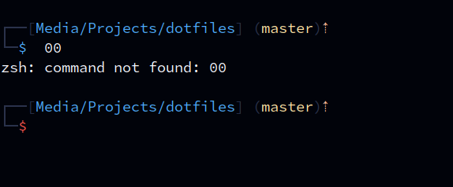

[Starship](https://starship.rs) draws the prompt — the text before your cursor. One config,
`~/.config/starship.toml`, drives both bash and zsh, so the prompt looks the same in both.

```
┌──[~/projects/dotfiles] (main) *
└─$
```



The layout is adapted from Kali Linux's default zsh prompt.

## What each part means

| Part | Colour | Notes |
|---|---|---|
| `┌──[` `]` `└─` and the `( )` | `muted` (very dark navy) | a barely-there frame |
| hostname | `teal` | **only over SSH** — so you know you're on another machine |
| path | `blue` | last 3 folders |
| branch | `yellow` | only inside a git repo |
| git status | `peach` | `*` modified, `+` staged, `?` untracked, `!` conflict, plus ahead/behind |
| `$` | `blue` / **`red`** | turns red when the last command failed |

There's a blank line before each prompt so command output is easy to tell apart.

## Colours

Colours come from a `[palettes.lasik]` palette that mirrors the
[Lasik VSCode theme](https://github.com/aamnah/lasik-vscode-theme). Change a hex value once and
every part using it updates:

```toml
[palettes.lasik]
blue   = "#4daafc"   # paths, $
yellow = "#FFE2A3"   # branch
peach  = "#fab795"   # git status
red    = "#f85149"   # $ after an error
muted  = "#2A324B"   # frame
```

:::note[TOML order matters]
Top-level settings like `palette = "lasik"` must come **before** the first `[section]` header.
TOML puts anything after a header into that section.
:::

## Installing

The installer installs starship if it's missing: `brew install starship` on macOS, the official
installer elsewhere. To do it by hand:

```sh
curl -sS https://starship.rs/install.sh | sh
```

Then activate it (the dotfiles already do this — only needed without them):

```sh
echo 'eval "$(starship init bash)"' >> ~/.bash_profile
echo 'eval "$(starship init zsh)"'  >> ~/.zshrc
```

## Edge cases

- **No starship** (minimal server, install failed): bash uses its
  [fallback prompt](/dotfiles/shell/bash/#prompt); zsh shows its plain default `%` prompt.
- **Icons show as boxes**: the terminal font has no Nerd Font icons. This config uses plain
  characters, but other tools might not — see [kitty](/dotfiles/terminal/kitty/#font-and-window).
- **Installer needs root for starship.** The official installer puts it in `/usr/local/bin` and
  may ask for your `sudo` password.
- **The `muted` frame is nearly invisible on light or high-contrast terminal themes** — by
  design on dark themes, but change `muted` if you use a light one.
- **Homebrew installs**: starship has to start after Homebrew's `PATH` is set. That's why its
  line is at the very end of `.zshrc`.
- The `username` section exists in the config but isn't in the prompt layout, so your username
  isn't shown.
