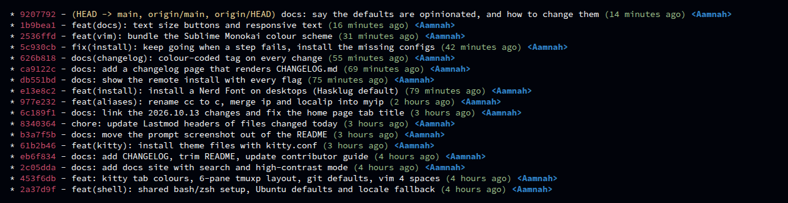

Two files: `.gitconfig` (defaults and aliases) and `.gitignore_global` (files to ignore
everywhere).

## What the installer does

Your `~/.gitconfig` holds your name, email and credentials, so the installer **doesn't replace
it**. Instead it adds the repo's settings one at a time with `git config --global`:

- A setting you **don't have yet** is added: `installed: git pull.rebase = true`
- A setting you **already have** is kept, even if it's different:
  `kept: git pull.rebase = false (yours; the dotfiles use true)`
- `.gitignore_global` is copied to `~/.gitignore_global`, and `core.excludesfile` is set to it,
  unless you already point git at another ignore file.

Nothing happens if git isn't installed (you get a warning).

## `.gitconfig` defaults

| Setting | Value | Why |
|---|---|---|
| `init.defaultBranch` | `main` | new repos start on `main` (GitHub's default) instead of `master` |
| `core.autocrlf` | `input` | Windows line endings (CRLF) become LF when you commit, never the other way. Stops files edited on Windows from showing every line as changed |
| `pull.rebase` | `true` | `git pull` puts your local commits on top of the remote ones instead of making a merge commit, so history stays a straight line |

To set them by hand instead:

```sh
git config --global init.defaultBranch main
git config --global core.autocrlf input
git config --global pull.rebase true
```

## `.gitconfig` aliases

| Alias | What it does |
|---|---|
| `git lg` | compact, coloured history graph of all branches |
| `git s` | `git status` |



`git lg` shows one line per commit: short hash (red), branch/tag names (yellow), message, age
(green) and author (blue), with a graph of how branches join.

The `[user]` section is empty on purpose — don't commit your email to a public repo.

### Set the aliases by hand

```sh
git config --global alias.s status
git config --global alias.lg "log --color --graph --pretty=format:'%Cred%h%Creset -%C(yellow)%d%Creset %s %Cgreen(%cr) %C(bold blue)<%an>%Creset' --abbrev-commit --branches"
```

`--global` writes to `~/.gitconfig`, adding to what's there.

## `.gitignore_global`

A list of files git should ignore in **every** repo: macOS and Windows clutter (`.DS_Store`,
`Thumbs.db`, `._*`), Python and C++ build output (`*.pyc`, `*.out`), `node_modules`, `venv`,
`.vscode` and cache folders.

Git only uses it if `core.excludesfile` points to it. The installer sets that up; by hand:

```sh
cp .gitignore_global ~/.gitignore_global
git config --global core.excludesfile "$HOME/.gitignore_global"
```

:::caution[It ignores `.vscode` and `*.out` everywhere]
- `.vscode` — if a project *should* share its VS Code settings, add them with
  `git add -f .vscode/settings.json`.
- `*.out` — the default name for programs compiled with `gcc`/`g++` (`a.out`). Fine for build
  output, but any other file ending in `.out` is ignored too.
:::
