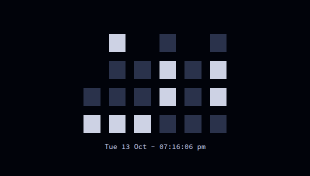

[peaclock](https://github.com/octobanana/peaclock) shows a responsive clock in the terminal, nice to show in a
terminal or pane of any size. By default it shows a binary clock, but more configs can be added.



The config, `.config/peaclock/config`, sets:

| Setting | Value                                                           |
| ------- | --------------------------------------------------------------- |
| View    | **binary** (switch to `digital`, `ascii`, `date` or `icon`)     |
| Time    | 24-hour, with seconds and the date (`Tue 13 Oct - 02:30:05 pm`) |
| Size    | fills the pane, keeping a 2:1 ratio                             |
| Colours | Lasik: light blocks on dark navy                                |
| Timer   | 40 minutes; sends a desktop notification when done              |

## Setup

The installer copies the config to `~/.config/peaclock/config`, but doesn't install peaclock
itself: it's built from source, see its [README](https://github.com/octobanana/peaclock#build).
Then run:

```sh
peaclock
```

The [`peaclock` alias](/dotfiles/shell/aliases/#tools) adds `--config-dir ~/.config/peaclock`
so it finds this config.

The timer's notification uses `notify-send`, so it only works on Linux desktops.
